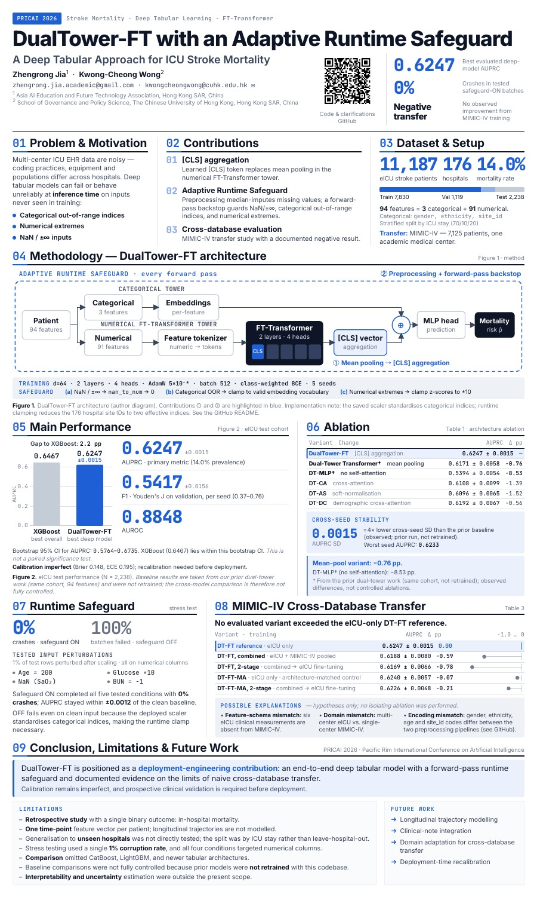

  

    <h1>Slides & Presentations</h1>
  

  

    <section class="content-section">
      
Conference Presentations

      

        

          

            DualTower-FT with an Adaptive Runtime Safeguard: A Deep Tabular Approach for ICU Stroke Mortality
            PRICAI 2026
          

          
<a href="https://2026.pricai.org/" target="_blank" rel="noopener noreferrer">The 23rd Pacific Rim International Conference on Artificial Intelligence (PRICAI 2026)</a> &mdash; Poster &middot; November 16&ndash;20, 2026 &middot; Guangzhou

          

            
          

          

            <a href="/assets/posters/PRICAI2026/PRICAI2026_DualTowerFT_Poster.pdf" class="btn btn-primary" target="_blank" rel="noopener noreferrer"><i class="fas fa-file-pdf"></i> Poster (PDF)</a>
          

        

        

          

            Deep Learning for Stroke Mortality Prediction in eICU: A Dual-Tower Transformer Framework
            CCAI 2026
          

          
<a href="https://ccai.net" target="_blank" rel="noopener noreferrer">2026 6th International Conference on Computer Communication and Artificial Intelligence (CCAI)</a> &mdash; May 24, 2026 &middot; Nanjing

          

            <iframe src="/assets/slides_html/CCAI2026.html" width="100%" height="520px" style="border:1px solid var(--color-border);border-radius:6px;display:block;" allowfullscreen></iframe>
          

          

            <a href="https://drive.google.com/file/d/16FePUDlv0bs38EvAamXJQVxBRFpne3AV/view?usp=sharing" class="btn btn-primary" target="_blank" rel="noopener noreferrer"><i class="fas fa-file-pdf"></i> Slides (PDF)</a>
            <a href="https://github.com/ZR-JIA/zr-jia.github.io/blob/main/assets/slides/CCAI2026/CCAI2026_Presentation.md" class="btn btn-outline" target="_blank" rel="noopener noreferrer"><i class="fab fa-github"></i> Source (.md)</a>
          

        

      

    </section>

  

